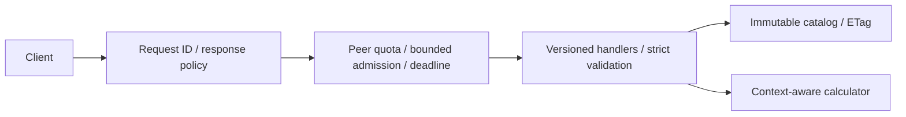

# Cynbit backend assessment

An evidence-bounded technical report and a standalone Go reference API for the
Cynbit Backend Developer Intern assessment. Standard library only; no credentials,
database or third-party services required.

> **Review status:** the reference implementation is runnable. The company-specific
> website audit is incomplete: public research was blocked by the environment's
> outbound proxy, and the official domain remains unverified. No target-origin
> headers, API payloads, vulnerabilities or performance results are asserted.
> See the [evidence ledger](docs/EVIDENCE.md) before interpreting any recommendation.

## Five-minute review

1. Read the [audit summary and scope](docs/AUDIT_REPORT.md).
2. Inspect the [conditional findings](docs/SECURITY_FINDINGS.md) and
   [evidence-to-code matrix](docs/RECOMMENDATIONS.md).
3. Run `make check`, then `make run` and the requests below.
4. Read the [architecture](docs/ARCHITECTURE.md) and
   [performance tradeoffs](docs/PERFORMANCE_ANALYSIS.md).

Assessment deadline supplied by the requester: November 1, 2026, 10:01 AM IST.
This package intentionally favors verifiable behavior over fabricated research.
Passive-only scope: public navigation and ordinary requests; no exploitation,
fuzzing, scanning, endpoint guessing, authentication bypass or production load tests.

## What the reference demonstrates

- Versioned JSON endpoints; strict required keys/types, duplicate/null rejection,
  4 KiB body limit and domain validation.
- Stable error codes, sanitized messages and server-generated request IDs.
- Public immutable catalog with ETag, GET/HEAD and conditional 304 responses.
- Per-peer bounded rate limiter, 32 active worker slots, deadlines and cancellation.
- Security response headers, no permissive CORS, no cookies or stored personal data.
- Explicit server read/write/idle limits, health/readiness and graceful shutdown.
- Structured JSON logs excluding request bodies and sensitive headers.
- Tests for contracts, limits, cache semantics, cancellation and concurrency.

**Illustrative domain:** the two catalog entries and effort-unit calculation are
invented examples, not Cynbit offerings, prices or discovered endpoints. POST
calculates a result without creating a persisted resource, so it returns 200.



## Run locally

Prerequisites: Go 1.24+ and Make (optional). Race tests require a supported C
compiler. Verified toolchain and results are recorded in [verification](docs/VERIFICATION.md).
No environment secrets or module downloads are needed. Use the existing checkout;
no worktree is required.

```sh
cd /path/to/assignment
make check
make run
```

The server defaults to `127.0.0.1:8080`. Stop with Ctrl+C; SIGTERM also drains.
`make build` produces `bin/server`. Without Make:

```sh
go vet ./...
go test -race ./...
go run ./cmd/server
```

For this cloud machine specifically, the installed Go binary is outside the repo:

```sh
export PATH=/workspace/.tools/go/bin:$PATH
export GOCACHE=/workspace/.cache/go-build
export GOPATH=/workspace/.cache/gopath
cd /workspace/assignment
make check
```

| Variable | Default | Constraints |
|---|---|---|
| `ADDR` | `127.0.0.1:8080` | host:port; use a free local port |
| `REQUEST_TIMEOUT` | `2s` | 1ms..30s |
| `RATE_PER_MINUTE` | `60` | 1..10000 per direct peer |

For example: `ADDR=127.0.0.1:8090 REQUEST_TIMEOUT=1s go run ./cmd/server`.
Configuration errors fail startup. No `.env` loader is included.

## Exercise the API

Local loopback addresses below are internal command examples, not public demos.

```sh
curl -i http://127.0.0.1:8080/healthz
curl -i http://127.0.0.1:8080/readyz
curl -i http://127.0.0.1:8080/v1/services
curl -I http://127.0.0.1:8080/v1/services
curl -i -H 'Content-Type: application/json' \
  -d '{"service_id":"api-review","integrations":2}' \
  http://127.0.0.1:8080/v1/estimates
```

Estimate response (request ID shortened here for readability):

```json
{"data":{"service_id":"api-review","effort_units":7,"disclaimer":"Illustrative units only; not a quote or Cynbit service."},"request_id":"..."}
```

Invalid domain input with `integrations:21` returns HTTP 422:

```json
{"error":{"code":"validation_failed","message":"service_id must be a catalog ID; integrations must be 0..20"},"request_id":"..."}
```

Use the actual `ETag` from the catalog response as `If-None-Match` on a subsequent
GET to receive 304 with no body. Catalog JSON contains only `data`; correlation is
in `X-Request-ID` to keep the cacheable representation stable. Every other normal
JSON response includes `request_id`. A canceled client may disconnect before any
response is delivered. Errors/calculations are `no-store`. Limit breaches return
413 (body), 429 (quota, with Retry-After) or 503 (capacity/deadline).

Run the local automated smoke script after building; it starts its own server,
uses a dedicated port and shuts down only its own process:

```sh
make build
python3 examples/smoke.py
```

## Decisions and limitations

- A stateless calculator demonstrates contracts without collecting contact details
  or guessing actual company workflows. No authentication claim is made.
- Fixed-window quotas are per process, capped at 1,024 peer keys, and fail closed
  for new peers when full. Restarts reset quotas. Boundary bursts are possible.
- Forwarded headers are ignored. A reverse proxy would collapse clients into one
  quota; configure a trusted edge deliberately before public deployment.
- Public catalog freshness is bounded at 60s. Cache IDs can represent an origin
  delivery; production edges may issue separate delivery correlation IDs.
- Worker slots remain held after timeout until work actually stops. Cooperative
  cancellation is mandatory for future dependencies.
- No TLS termination, distributed quota, durable storage, identity provider,
  telemetry backend, retries or deployment is included. See [ADRs](docs/RECOMMENDATIONS.md).
- Public source visibility and fresh-environment restoration are not guaranteed
  merely by pushing a repository. Confirm repository access before submission.

## Reports

- [Audit report](docs/AUDIT_REPORT.md)
- [Evidence and safe follow-up](docs/EVIDENCE.md)
- [Security findings](docs/SECURITY_FINDINGS.md)
- [Performance and reliability](docs/PERFORMANCE_ANALYSIS.md)
- [Architecture diagrams](docs/ARCHITECTURE.md)
- [Recommendations, traceability and ADRs](docs/RECOMMENDATIONS.md)
- [Actual verification results](docs/VERIFICATION.md)
- [Assessment submission text](docs/SUBMISSION.md)

The highest-priority remaining task is to obtain permitted public-site evidence,
verify the official company domain, and replace conditional applicability with
supported findings. Do that before presenting this as a completed Cynbit audit.
