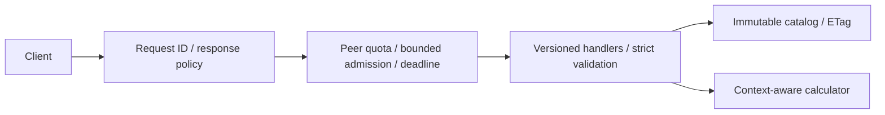

# Cynbit Backend Technical Assessment

A passive review of [Cynbit's public website](https://www.cynbit.in/) and a Go
reference API demonstrating the recommended HTTP, validation and reliability
controls. Prepared for the **Backend Developer Intern** assessment.

**Review date:** October 31, 2026 (IST). **Implementation:** Go standard library;
no database, credentials or third-party Go dependencies.

## Start here

| Review goal | Read or run |
|---|---|
| Understand the assessment in five minutes | [Audit report](docs/AUDIT_REPORT.md) and the findings below |
| Check the supporting evidence | [Evidence ledger](docs/EVIDENCE.md), [sanitized observations](docs/evidence/public-observations.json), [empty-form screenshot](docs/evidence/contact-form.png) |
| Inspect the proposed improvements | [Recommendations and test traceability](docs/RECOMMENDATIONS.md) |
| Evaluate the implementation | `make check`, then `make smoke` |
| Prepare the submission | [Submission text](docs/SUBMISSION.md) and [completion checklist](docs/COMPLETION_CHECKLIST.md) |

## Findings at a glance

| Observation | Why it matters | Recommendation |
|---|---|---|
| Inquiry/demo fields have required/email constraints but no HTML length caps | Client and server contracts should agree; backend limits remain unverified | Define shared limits and enforce them independently on the server — F-001 |
| Inspected Server Action callers lack local rejection cleanup | A rejected call could bypass pending-state reset | Handle exceptions and reset UI state in `finally` — F-004 |
| Sampled document responses include HSTS but omit several other security headers | Browser response policy can be strengthened | Review framing, referrer and MIME policy; stage a Next.js-compatible CSP — F-005 |
| Application labels require DOB, address and multiple contact fields | Initial collection should have a clear hiring purpose | Review necessity, collection stage, access and retention — F-007 |
| Marketing pages return cache hits and validators; careers/blog use no-store | There is already useful cache separation | Preserve it and measure freshness needs before changing dynamic routes — F-003 |

[Full findings](docs/SECURITY_FINDINGS.md) also cover resource limits and analytics
cookies. Each distinguishes direct observations, source-based inferences and
proposed controls. No exploited vulnerability or production bottleneck is claimed.

## Scope

The review used ordinary public navigation, response headers, empty form schemas,
and browser-loaded JavaScript. It covered services, products, contact, careers,
the backend internship, blog pagination, and privacy/cookie policies. No forms
were submitted or authenticated product workflows tested.

The site identifies as Cynbit Technologies and lists the matching internship.
The assessment email did not provide a domain, so independent ownership
verification is limited. Server-side validation, authorization, database behavior
and delivery guarantees require separate internal or authorized staging access.
See the [evidence ledger](docs/EVIDENCE.md) for timestamps and precise limits.

## Reference implementation

The API uses an illustrative catalog and stateless effort calculator to demonstrate
controls without collecting applicant data or depending on production services.
Its service names, units and endpoints are examples, not Cynbit's actual offerings
or discovered APIs.

- **Contracts:** versioned routes, strict JSON types/keys, required fields,
  duplicate/null rejection, 4 KiB body cap and domain validation.
- **Security:** safe errors, generated request IDs, response headers and bounded
  peer quotas; request bodies and credentials are excluded from logs.
- **Reliability:** bounded active work, context deadlines, health/readiness,
  server timeouts and graceful shutdown.
- **Caching:** stable public representations, ETags, GET/HEAD and conditional 304s;
  estimates and errors use `no-store`.



[Architecture diagrams](docs/ARCHITECTURE.md) compare observed public interactions
with the proposed design. [Engineering decisions](docs/RECOMMENDATIONS.md) explain
why the example uses in-memory quotas and avoids speculative infrastructure.

## Quick start

Requires **Go 1.24+**, Make and a C compiler for race detection. The optional smoke
script requires Python 3. Verified toolchain: Go 1.27.3 on Linux amd64.

```sh
git clone https://github.com/shantanu-1607/assignment.git
cd assignment
make check       # formatting, vet and race tests
make smoke       # build, real HTTP checks and SIGTERM shutdown
make run         # development server on 127.0.0.1:8080
```

From an existing checkout, start with `make check`. Stop the server with Ctrl+C.
`make build` produces `bin/server`. Without Make, use `go vet ./...`,
`go test -race ./...`, and `go run ./cmd/server`. Cloud-specific tool activation
is documented in [verification notes](docs/VERIFICATION.md#cloud-workspace-notes).

In another terminal:

```sh
curl -i http://127.0.0.1:8080/v1/services
curl -i -H 'Content-Type: application/json' \
  -d '{"service_id":"api-review","integrations":2}' \
  http://127.0.0.1:8080/v1/estimates
```

The estimate returns HTTP 200 (request ID abbreviated):

```json
{
  "data": {
    "service_id": "api-review",
    "effort_units": 7,
    "disclaimer": "Illustrative units only; not a quote or Cynbit service."
  },
  "request_id": "..."
}
```

The [API reference](docs/API.md) documents all routes, error codes, configuration
and conditional caching examples. These commands run locally; no public demo is
deployed.

## Validation and tradeoffs

Formatting, vet, 16 top-level tests, race detection and real HTTP/shutdown smoke
checks passed locally. [Hosted CI](https://github.com/shantanu-1607/assignment/actions/workflows/check.yml)
also passed for the recorded milestone; exact run/commit evidence is in
[VERIFICATION.md](docs/VERIFICATION.md).

The limiter is per process, capped at 1,024 peers, and resets on restart. Fixed
windows permit boundary bursts. Forwarded headers are ignored; a real reverse
proxy needs an explicit trusted identity policy. Timed-out workers retain their
slots until they exit, so future dependencies must honor cancellation.

Public deployments would additionally need HTTPS termination and appropriate
operational controls. Authentication, durable storage, distributed quotas and
email delivery are outside this stateless example. [Performance analysis](docs/PERFORMANCE_ANALYSIS.md)
explains which follow-up measurements would justify adding them.

## Repository guide

| Path | Purpose |
|---|---|
| `cmd/server/` | HTTP server configuration, signals and shutdown |
| `internal/api/` | Routes, validation, middleware, rate limiter and behavior tests |
| `internal/service/` | Context-aware calculator and illustrative catalog |
| `internal/config/` | Validated environment configuration |
| `examples/smoke.py` | Local HTTP and graceful-shutdown verification |
| `docs/` | Audit, evidence, API reference, diagrams, decisions and submission text |

Before sharing the repository URL, confirm reviewer access using the
[submission checklist](docs/COMPLETION_CHECKLIST.md#before-portal-submission).
