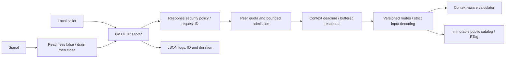
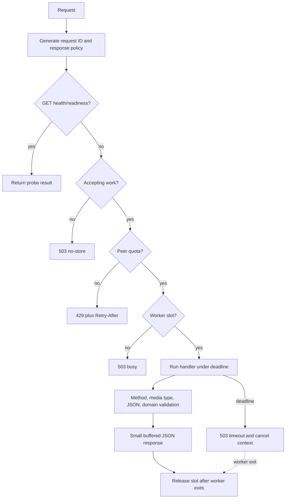

# Architecture

## Observed research path

No target backend, API, database, CDN or authentication provider can be inferred
from this path.

## Proposed standalone design

For an actual public deployment, place an independently configured HTTPS edge
before B and configure trusted proxy behavior. This diagram claims no deployed
infrastructure.

## Error and middleware flow

## Package boundaries

- `cmd/server`: process lifecycle and HTTP server limits.
- `internal/config`: validated non-secret environment configuration.
- `internal/api`: HTTP contract, response policy, limiter and admission.
- `internal/service`: HTTP-independent deterministic domain logic.

Tests inject an estimator to demonstrate cancellation, failure hygiene and
concurrency admission without calling production systems.
