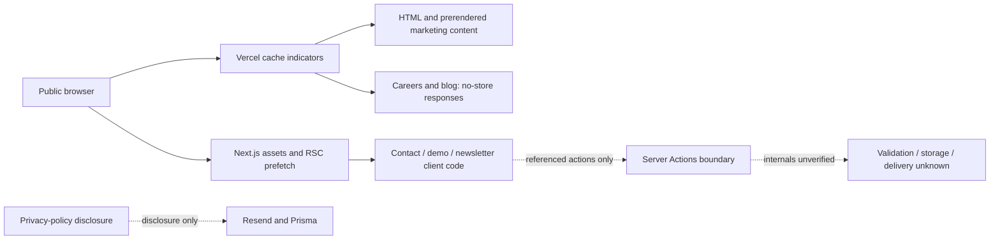
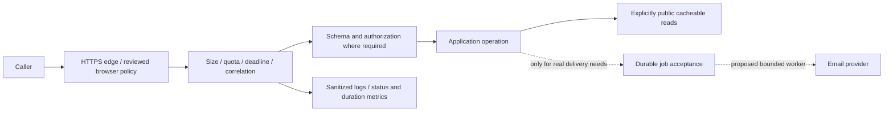
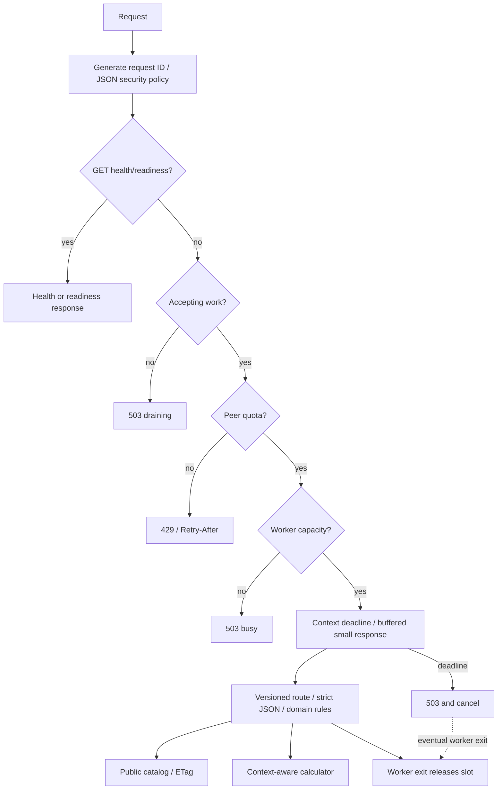

# Observed and proposed architecture

## Public request flow (E-008–E-017)

Solid edges describe captured navigation/response behavior; dotted edges describe
client-code references or policy disclosures without backend execution proof.
No database engine, service topology or product authentication stack is inferred.

## Proposed application boundary

This is a recommendation, not deployed Cynbit infrastructure. A durable queue is
conditional on real delivery requirements and is not added to the stateless demo.

## Implemented Go reference

Packages: `cmd/server` owns process/server lifecycle; `internal/config` validates
non-secret configuration; `internal/api` owns contracts and HTTP resource policy;
`internal/service` owns deterministic logic. Tests inject estimators to simulate
failure/cancellation locally. No test touches Cynbit.
